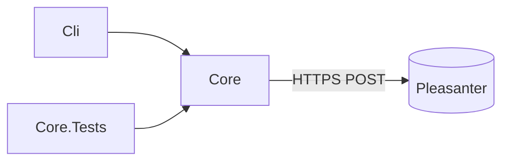

# アーキテクチャ方針

## 位置づけ

Pleasanter の標準 Web API を叩く別アプリを作るための土台です。Pleasanter 本体のコードは取り込みません。派生著作物にしないことで、ライセンスの選択肢（[ライセンス](ライセンス.md)）を残します。

## 構成

- `Core`: Pleasanter API クライアントと接続設定。UI や実行形態に依存しない
- `Cli`: 接続確認の CLI。ツール固有の処理はここか、新しいプロジェクトへ足す
- `Core.Tests`: クライアントの単体テスト。通信はスタブで差し替える

## 決めたこと

- **API キーはリクエストボディに載せる。** Pleasanter にヘッダ方式は無い。根拠は `_reference/Implem.Pleasanter` の `Implem.Pleasanter/Libraries/Requests/Context.cs`（参照日 2026-10-12、固定位置 `Pleasanter_1.5.8.1`）。そのためブラウザから直接 API を叩く設計にはできず、キーはサーバ側だけが持つ
- **クライアントは再試行しない。** 応答を `PleasanterErrorKind` で分類して返し、再送するかは呼び出し側が決める。応答が返らなかった場合（`Unknown`）は、できたかどうか分からないため照合してから判断する
- **ランタイムは Pleasanter 本体に揃える。** .NET 10 / net10.0
- **依存は寛容ライセンスに限る。** デュアルライセンスを選べる状態を保つため

## 未決定

- `ApiVersion` の既定値 `1.1` を、固定位置のソースで再確認していない。ツールを作るときに確認して、ここへ出典を残す
- 実機の Pleasanter に対する動作確認は行っていない（単体テストはスタブのみ）
