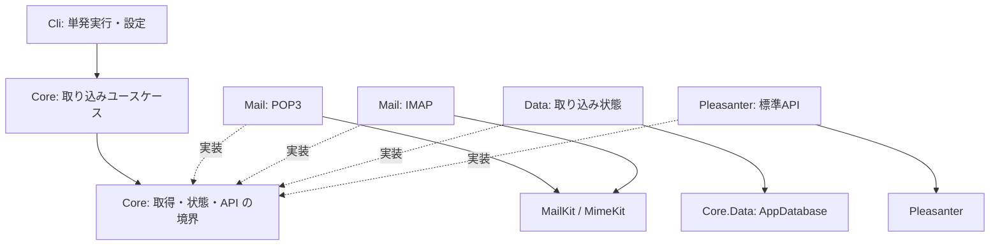
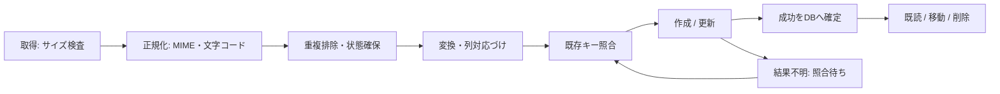

# アーキテクチャ方針

<!-- markdownlint-configure-file {"MD013": {"line_length": 120}} -->

## 1. 状態・目的・範囲

**第 1 段階のレビュー用設計メモ（2026-10-22）。実装はまだ行わない。**
本文の「推奨」は承認待ちの案であり、確定仕様ではない。
ただしメールの TLS は必須にせず、平文を明示設定で許可することは利用者決定。
本メモでは接続保護の既定値を `Tls` とする。例外の詳細と残る論点は第 3・8 節に記す。
現状の成果物はテンプレート名を置換した最小 API クライアントと接続確認 CLI。
受信・設定例の読込み・状態 DB・マッピング・再試行はすべて未実装。

目的は POP3 / IMAP のメールを取得し、正規化・重複排除・列への対応づけを経て、
Pleasanter 標準 Web API でレコードを作成・更新すること。
対象は Pleasanter 1.5 系以降。全 1.5 系の互換性を確認済みという意味ではない。

| 区分 | 内容 |
| --- | --- |
| 第 2 段階の実装候補 | POP3 / IMAP の 3 保護モード、パスワード認証、テキスト化、JSON 対応づけ、状態管理、単発 CLI |
| 後続段階の推奨 | OAuth2 のトークン取得・更新、添付の Pleasanter 転送、管理画面、スケジューラ、Docker |
| 対象外 | SMTP 送信、返信、スレッド単位のチケット統合、メールサーバ管理、サイトの自動作成 |

「同じメール」の更新と「返信を既存案件へ紐付ける」は別問題。
第 2 段階では同一外部キーの再処理だけを更新対象とし、件名・差出人一致で別メールを上書きしない。
RSS / Atom の受信は別ツール FeedIngest の範囲。

詳細は [対応づけ設定](メール対応づけ設定.md)、[状態管理と API](取り込み状態とAPI.md)、
[一次情報と確認記録](設計の参照資料.md) に分離する。

Pleasanter 本体は AI の事実確認用に必要時取得し、Git では追跡しない。
読む前に `bash scripts/sync-reference.sh` で上流 `main` を更新する。
CI・ビルド・配布物へは含めず、文書に完全な SHA・固定リンク・参照日を残す。
[2026-10-22 の確認記録](設計の参照資料.md#5-pleasanter-参照ソースでの事実確認) は
過去の確認版を示し、取得した最新の版で再検証済みという意味ではない。実機は未検証。

## 2. 全体構成

プロジェクト名の接頭辞は `VehicleVision.PleasanterTools.MailIngest`。

| 層 | 責務・依存 |
| --- | --- |
| `.Core` | 正規化メール、マッピングと検証、重複キー規則、取り込みユースケースと境界インターフェース |
| `.Mail` | POP3 / IMAP の各アダプター、MailKit / MimeKit、取得・MIME 変換・受信後操作 |
| `.Pleasanter` | 標準 API、列の型変換、応答検証。既存 `.Core` の API クライアントと接続設定を移す |
| `.Data` | ツール固有の取り込み状態・排他。Core.Data の AppDatabase と DB 基盤を再利用する候補 |
| `.Cli` | DI・秘密設定・引数・終了コード、1 回の実行。業務ロジックは置かない |
| `tests` | 層別の単体試験と SQLite 状態試験、ローカルの POP3 / IMAP フェイク |

POP3 と IMAP は `.Mail` 内の別クラスから始め、プロジェクトの過分割はしない。
`.Core` は DB ドライバ・HttpClient・MailKit の型を公開せず、外部層が `.Core` の境界を実装する。
実行ユースケースは後から Worker / 管理画面へ接続できるが、常駐ホストは今は作らない。

取得時に UIDL / UID による軽い既処理判定はできるが、Message-ID は MIME 正規化後に検証する。
ダウンロード、レコード作成、受信後処理は別の成功状態として扱う。

### Core の再利用

Core の「コア化の方針」、`AppDatabase.cs`、Core.Mail の csproj と中央版定義を参照した。

- **Core.Data 推奨**: アプリ ID `mailingest` を渡す。`mailingest.db`、
  `MAILINGEST_DB_PROVIDER` / `MAILINGEST_DB_CONNECTIONSTRING` / `MAILINGEST_DB_ALLOW_INSECURE`、
  マイグレーション排他名は AppDatabase が導く。手書きで複製しない
- DB 時刻はネイティブ日時、書込み `DbTime.ForDb`、読込み `DbTime.AsUtc`。
  共有接続・方言・マイグレーションをコピーしない。アプリ固有の表と SQL だけを持つ
- **Core.Mail は今回は参照しない推奨**: 既存は SMTP / SES / ACS の送信部品で、受信境界は無い。
  名前だけを理由に不要な送信 SDK を追加せず、MailKit を直接利用する。将来共通化は別途提案する
- **Core.Web は今回は不要**: Pleasanter のセッション本人確認は非対話 CLI では使わない
- Core は **AGPL / 商用のデュアルであり寛容 OSS ではない**。
  自社部品としての商用再許諾の根拠確認を採用条件とする。未確認のままパッケージを追加しない。
  Core.Data の SqlClient 推移依存には独自許諾の SNI.runtime もある。
  Core 側の例外許容を本ツールへ自動転用しない。寛容 OSS 限定との整合も採用前の保留条件。
  代替は Pleasanter 側状態案（後述）。独自 DB 基盤の複製で逃げない

Core の確認対象は公開タグ `v0.1.0-preview.10` とローカル固定コミット。
第 2 段階着手時に nuget.org の公開版・同梱ライセンスを再確認して固定し、NOTICE とロックを更新する。
Core の Dapper / ドライバを再宣言しない。DotNetClient は未公開・LGPL のため依存にしない。

## 3. 接続と認証（推奨案）

| 設定 | 推奨動作 |
| --- | --- |
| `tls: None` | 平文。POP3 110 / IMAP 143 が既定ポート。明示した場合だけ許可 |
| `tls: StartTls` | POP3 STLS / IMAP STARTTLS。既定ポート 110 / 143 の同じ接続を昇格 |
| `tls: Tls` | 暗黙 TLS。POP3 995 / IMAP 993 が既定ポート。MailKit の `SslOnConnect` に対応 |
| 保護の既定値 | `tls` 省略時は `Tls`。ポートから保護方式を推測せず、平文へ自動降格しない |
| 自動選択 | `Auto` / `StartTlsWhenAvailable` は設定として許可しない |
| TLS の失敗 | `Tls` / `StartTls` の確立失敗・昇格非対応は停止。認証せず `None` へ再接続しない |
| TLS プロトコル版 | TLS 利用時は 1.2 以上、OS の安全な選択を尊重。古い TLS だけの接続先は拒否 |
| 第 2 段階の認証 | ユーザー名・パスワード。保護モードと明示的な許可リストで送信方式を制限 |
| OAuth2 | 後続を推奨。XOAUTH2 対応ライブラリとトークン取得・安全な更新運用は別問題 |
| タイムアウト | 接続・認証・各操作 30 秒、1 通 120 秒を初期候補。キャンセルを下層まで渡す |

Microsoft 365 / Gmail 等でパスワード認証を禁止している環境は、第 2 段階案では利用できない。
これが主な利用環境なら OAuth2 を第 2 段階へ前倒しする必要があるため、未決事項とする。
平文 POP3 110 の既存環境を扱うため、TLS を一律の接続条件にしない。
既定は `Tls` とする。暗号化忘れを避け、接続直後から保護し、平文への自動降格を防ぐため。
代替は `StartTls` 既定だが、既存ポートを維持できる一方でサーバの昇格対応が必要。
`None` 既定は暗号化忘れにつながるため採らない。接続先に合わせて運用者が明示的に変更する。
メール接続先・Pleasanter URL は運用者だけが設定する。この決定は API 接続の保護を変更しない。

### 平文の警告と認証方式

`None` は信頼できるネットワーク内だけで使用する。
設定検査・起動時と各接続試行の認証前に、sourceId 付きの警告を必ず出す。
「認証方式によって認証情報（パスワードを含む）が平文で流れ、本文も暗号化されない」と明示する。
パスワード・ユーザー名・本文・認証応答は警告にも含めず、プロトコルログも有効にしない。

| 認証方式 | `Tls` / `StartTls` 確立後 | `None` |
| --- | --- | --- |
| POP3 USER/PASS、IMAP LOGIN コマンド | プロトコル別の既定許可候補 | 既定無効。方式指定と危険な認証の明示許可が必要 |
| SASL PLAIN / LOGIN | 既定許可候補。base64 は暗号化ではない | 既定無効。同上。パスワード相当が盗聴可能 |
| POP3 APOP、SASL CRAM-MD5 | 既定無効。互換性が必要な場合だけ個別許可 | 既定無効。個別許可しても安全な平文接続とは扱わない |
| その他の MailKit 対応 SASL | 必要な方式を評価し個別許可 | 個別評価・許可。未評価の方式を自動で有効にしない |

APOP / CRAM-MD5 はパスワード自体を送らないが、古い MD5 系の方式であり、
辞書攻撃等への懸念がある。本文の機密性や通信全体の改ざん防止を提供せず、TLS の代替にしない。
`None` の認証許可リストは既定で空とし、非空の明示指定を起動条件とする。
USER/PASS・IMAP LOGIN・SASL PLAIN/LOGIN には、さらに
`allowInsecurePasswordAuthentication: true` を要求する。どの方式も個別に無効化できる。
詳細と旧式 POP3 の明示例は [対応づけ設定](メール対応づけ設定.md) を参照。

サーバ広告・MailKit 対応方式・設定許可リストの共通部分だけを候補にし、一致しなければ停止する。
SASL の `AuthenticationMechanisms` を絞るだけでは非 SASL の経路は防げない。
APOP、USER/PASS、IMAP LOGIN への暗黙フォールバックも制御し、許可外の認証は送信しない。
`StartTls` は昇格と証明書検証の成功後にだけ認証する。

追加案として、`None` でパブリックなホスト名・公開 IP へ向かう設定には強い警告を出す。
名前だけでは社内限定か判定できず、split DNS・複数 IP・名前解決失敗もあるため、
判定不能も注意扱いとし、私設 IP だけでも安全とは保証しない。
接続禁止や DNS 検査は必須条件にせず、判定規則・警告コードはレビューで決める。

### TLS の証明書検証と自己署名証明書

`Tls` / `StartTls` の `certificateValidation.mode` は `Strict` が既定。
OS の信頼ストアでチェーン・ホスト名・有効期間等を検証し、失敗すれば認証前に停止する。
社内 CA / 自己署名証明書は、まず運用で正しい信頼アンカーを登録して `Strict` を維持する。

検証を緩める `AllowUntrusted` はソース単位の明示設定だけに限定する案。
信頼アンカー未登録によるチェーンエラーだけを例外とし、ホスト名不一致・期限切れ・
証明書欠落・その他の検証失敗は拒否する。無条件に全証明書を受け入れる設定は設けない。
起動時と各接続時に、中間者攻撃のリスクと検証緩和を警告する。認証情報はログへ出さない。

より限定的な代替案は `Pinned`。別経路で確認したサーバ証明書 DER 全体の SHA-256
フィンガープリントを設定し、完全一致時だけ未信頼チェーンを例外にする。
ホスト名・有効期間等の検査は残し、ピン不一致なら通常の検証が成功しても拒否する。
初回接続でピンを自動登録せず、起動時と各接続時にピン例外利用を警告する。
証明書更新時のピン切替手順・一時的な複数ピンの可否は未決。
MailKit の接続前コールバックで実現可能か、例外にするチェーン状態も含め先行試験する。
`None` で証明書例外を指定しても暗号化されないため、既定以外の証明書設定は起動エラーにする。

## 4. 取得と受信後の扱い（推奨案）

| 方式 | 取得 | 成功後の指定 |
| --- | --- | --- |
| POP3 | LIST で事前サイズ、UIDL で位置を識別。通番は再接続後の識別子にしない | `leave` 既定 / `delete` 明示 |
| IMAP | 対象フォルダ指定、UIDVALIDITY + UID、サイズ取得、本文は PEEK で読む | `leave` 既定 / `markSeen` / `move` / `delete` 明示 |

IMAP の検索は `all` / `unseen` と任意の受信日時下限から構造化して組み立てる。
生の検索文字列を実行しない。既定候補は `all`。
`unseen` だけでは他クライアントが既読にした未取込メールが漏れるため、差分カーソルの代わりにしない。
日付下限や既読条件で対象外になったメールを取り込んだと表示しない。
1 回 100 通・取得同時数 1 を初期候補とし、全件バッファを作らず順に処理する。
候補件数が上限を超えたら、次回へ残った件数・状態を返す。IMAP の全 UID 一括展開も避ける。

**API 成功かつ状態永続化後だけ受信後操作を行う。** 失敗・不正 MIME・容量超過では残す。
既処理で DB が `AckPending` の場合は API を再実行せず受信後操作を再開する。
POP3 の削除は DELE の応答だけで確定とせず、QUIT 成功まで追跡する。
QUIT 応答不明では再接続して UIDL の存在を照合する。UIDL 非対応の場合は削除を拒否する。
`leave` でも UIDL が無ければ毎回の再取得が必要になるため、対応可否はレビューで決める。

IMAP `move` は移動先必須・事前存在確認、同一フォルダへの移動は禁止。
MOVE 非対応サーバでは自動で COPY + DELETE に置換せず、未対応として停止する案を推奨。
`delete` は UID 指定の削除・expunge を保証できる UIDPLUS が必要。
他メールまで消す全フォルダ EXPUNGE は使わない。
UIDVALIDITY 変更時は UID カーソルを無効化し、外部キーで再照合する。
移動の応答不明では元 UID の消失だけで成功と断定せず、移動先との照合か手動確認へ回す。
受信後操作の曖昧さを再作成で解決しない。

## 5. 日本語・MIME・本文・添付

MimeKit の構造化パーサーで MIME と encoded-word / 転送エンコーディングを解釈する。
ISO-2022-JP / Shift_JIS / UTF-8、折返し件名、multipart/alternative、base64、
quoted-printable を合成テストデータで確認する。日本語コードページは .NET の provider を登録する。
宣言 charset が不明・復号不能なら内容を推測して成功にせず、`InvalidEncoding` に分類して残す。
既知の charset 誤宣言を許容する案は、送信元別の明示設定を後続で検討する。

推奨は **text/plain 優先、無ければ HTML をテキスト化**。
MimeKit の `HtmlTokenizer` を利用した限定的テキスト抽出を候補とし、
script / style の除去、改行、リンク表示文字列を試験する。
確認した版に `HtmlToText` というクラスはなく、存在を前提にしない。
トークナイザーは HTML サニタイザーではない。HTML をそのまま Pleasanter へ保存・表示しない。
得られたテキストも Pleasanter の Markdown として安全とは限らないため、
HTML 特殊文字・Markdown 記法をリテラル化する変換を設け、利用先の表示仕様を確認する。
外部画像・URL・CSS を取得せず、CID を解決せず、添付内 HTML を本文に昇格しない。
S/MIME / PGP の復号や署名検証は対象外。暗号化本文しかない場合は未対応として残す。

| 制限の初期候補 | 超過時 |
| --- | --- |
| 受信 RAW 合計 25 MiB / 通 | 事前検査と実ストリームの両方で中断 |
| ヘッダ合計 256 KiB、MIME 深さ 32、パート 100 | 検査可能な境界で拒否し、無制限再帰させない |
| 本文デコード後 1 MiB | 途中切捨てで登録せず、容量エラー |
| API 応答 2 MiB / 回 | 異常応答として停止し、大きい本文をログしない |

これらは実測値ではなくレビュー用の上限案。サーバ申告サイズは信用せず、読み込み上限も必須。
MimeKit の全解析後だけサイズ確認する実装は不可。
`ParserOptions.MaxMimeDepth` は存在するが、超過時は例外でなく葉として扱う仕様。
設定するだけで「深さ超過を拒否した」としない。
パート数・深さ超過検出・デコード量の強制方法を第 2 段階の先行試験にする。
上限を保証できなければ未実装のまま残し、安全と説明しない。

**添付の Pleasanter 転送は後続へ分ける推奨。**
第 2 段階では添付を解凍・実行・保存・アップロードしない。
添付数と安全化した名前のメタデータだけを選択的に記録できる形にする。
添付を転送しないことをサマリーへ明示する。名前もパス区切り・制御文字・長さを検査する。
添付ありで削除・移動するとデータの保管場所が変わるため、既定は元メールを残す。
破壊的操作は「添付未転送」を承知した明示設定がある場合だけを候補とする。

後続の添付設計では、デコード後の個別・合計サイズ、個数、拡張子・MIME と実体、
ウイルス検査、隔離保管・暗号化・保持期限、CID / TNEF、ストリーム上限を定める。
`AttachmentsHash` の `Name` / `Base64` / `Added` と削除用 `Guid` / `Deleted`、
Base64 膨張、既存添付の差分、応答不明時の二重追加を個別に試験する。
Q の実機記録を本ツールの実機確認として流用しない。

## 6. 設定・ログ・エラー

非秘密 JSON は [対応づけ設定](メール対応づけ設定.md) の形とする。
秘密は環境変数か `_FILE`。設定 JSON には秘密そのものも `${ENV}` 展開式も置かず、変数名だけ参照する。
本文から接続先・認証・列名を指定させない。

`NAME` と `NAME_FILE` の同時指定は起動エラー。ファイルは絶対パス、UTF-8、64 KiB 以下、
末尾の改行 1 個だけ除去、空・不読は起動エラーとする。JSON の秘密へのフォールバックはしない。
OS 権限で実行者以外の読取りを制限し、ファイルパス・内容もログへ出さない。
Q の `_FILE` の競合検査を参考にするが、例外のパス表示は本ツールへ持ち込まない。
DB 接続文字列も同じ規則で解決して Core.Data へ渡す。秘密鍵の生成・DB 内の秘密暗号化は今回は不要。

| 分類 | 例 | 扱い |
| --- | --- | --- |
| 設定・認証 | 列不足、秘密競合、許可外の証明書・認証方式、401、メール認証拒否 | 対象ソース停止、人の修正待ち |
| 一時的 | 接続前の失敗、429、メールサーバ一時拒否 | 制限付き待機、次回へ状態を残す |
| 内容・変換 | 不正 MIME、文字コード、サイズ、必須値、型変換 | そのメールを保留、後続メールは継続 |
| 結果不明 | 作成応答の喪失、送信後タイムアウト、受信後操作の応答喪失 | 自動再送でなく照合待ち |
| 競合 | 同一キー複数、同一 Message-ID の別内容、手動編集との衝突 | 保留し、人が判断 |

構造化ログは runId・sourceId・状態 ID・エラーコード・件数・所要時間・HTTP コードだけを許可する。
接続保護の警告では保護モード・証明書検証モード・警告コード・固定の注意文も許可する。
平文と証明書例外の警告条件は第 3 節のとおり。接続先の生の文字列や秘密値を追加しない。
本文・HTML・RAW・件名・差出人・宛先・生 Message-ID・添付名・API 応答文・パスワード・ApiKey は出さない。
MailKit の ProtocolLogger と HTTP のボディログは有効化しない。
ログ用識別子は DB のランダム ID を使い、個人情報のハッシュを安全とみなして公開しない。
ヘッダの正規の折返しを解析後、CR / LF / NUL 等を各単一行フィールドで拒否する。
本文内の改行は維持する。ヘッダを URL・SQL・ログ書式へ連結しない。
広い catch で「成功」「空本文」に置き換えず、分類できない例外は失敗として終了する。

CLI は `run --config <path>` / `validate --config <path>` を第 2 段階の案とする。
終了コード案は 0 = 対象分成功、1 = 処理エラー・照合待ちあり、2 = 起動設定不正、
3 = 件数上限による未処理残あり。0 件は成功件数 0 と明示し、疎通済みと混同しない。
現在の `check` はテンプレートの疎通確認だけで、上記コマンドはまだ存在しない。

## 7. テスト方針

本段階は既存 7 件のスタブ試験・Release ビルド・Markdown lint・指示同期・参照分離のみ。
以下は **第 2 段階で追加する試験** で、現時点の成功結果ではない。
外部のメール・Pleasanter 実機や資格情報を CI へ与えない。

| 層 | 主なケース |
| --- | --- |
| Core | JSON 検証、固定値・既定値・型・欠落・長さ、キーの安定性、重複・衝突・設定更新 |
| MIME | 日本語 3 種、誤宣言、不正 base64、欠落境界、深い入れ子、NUL / CRLF、HTML のみ |
| Mail | POP3 / IMAP 各 3 保護モード、昇格失敗、証明書と認証の制限、UIDL / UIDVALIDITY、PEEK、切断 |
| API | HttpMessageHandler フェイク、パス・大小文字・ApiKey / ApiVersion、列ハッシュ、ページング |
| 冪等性 | サーバだけ成功、照合 0 / 1 / 複数、古い検索結果、再起動、二重起動、DB 消失 |
| 受信後 | API 前は非破壊、DB 確定前に操作しない、QUIT / MOVE 応答喪失、他 UID を消さない |
| 負荷境界 | RAW / デコード / ヘッダ / パート数の上限ちょうどと +1、キャンセル、定常メモリ |
| 秘密 | 環境変数と _FILE の排他、空・上限・権限、例外・ログ・サマリーへの漏出が無い |
| Data | SQLite 一時 DB、ユニーク制約、トランザクション、運用排他、マイグレーション |

フェイクは MailKit を差し替えたモックだけでなく、ループバックの POP3 / IMAP 応答も使う。
両プロトコルについて以下の行列を合成資格情報・試験専用証明書で検証する計画。
固定の標準ポートを占有せず、一時ポートを使う。既定ポートの解決は設定の単体試験で確認する。

| 対象 | フェイクで確かめること |
| --- | --- |
| `None` | 暗号化なしで取得、起動時・接続試行ごとの警告、明示許可なしの危険な認証を送らない |
| `StartTls` | POP3 STLS / IMAP STARTTLS で同じ接続を昇格、成功するまで認証しない |
| 昇格失敗 | 拡張なし・拒否・途中切断・TLS 失敗で停止し、平文認証や平文での再接続をしない |
| `Tls` | 接続直後から TLS。ハンドシェイク失敗でも他モードへ自動切替しない |
| 認証制限 | USER/PASS・APOP・SASL 各方式・IMAP LOGIN の許可と拒否、許可外の自動フォールバック防止 |
| `Strict` | 試験用の信頼設定で成功し、未信頼・期限切れ・ホスト名不一致・証明書欠落は拒否 |
| 証明書例外案 | `AllowUntrusted` の例外範囲、`Pinned` の一致・不一致、期限・名前検査の維持、警告 |
| 設定とログ | 省略時 `Tls` と既定ポート、未知値・矛盾設定拒否、警告にもパスワード・本文が出ない |

外部向け平文の強い警告案を採る場合は、DNS 応答を差し替え、私設・公開・混在・判定不能を試す。
合成メールを使い、実在の受信メールをテスト資産へ保存しない。
将来の実機検証は別作業として承認を得る。本段階では全実機挙動が未確認。

## 8. 未決事項とレビューで決めること

| 論点 | 推奨案 | 代替案・リスク |
| --- | --- | --- |
| 状態の所在 | Core.Data + 専用 DB、Pleasanter へ予約キー併記 | Pleasanter だけは応答不明・排他・受信後再開が弱い |
| Core の許諾 | 再許諾根拠・SNI 推移依存を確認して使用 | 寛容 OSS と誤認しない。依存分割等は Core 側の別提案 |
| 接続保護（決定） | 3 モード、既定 `Tls`、`None` は明示だけ | `StartTls` 既定案は不採用。平文の盗聴・改ざんリスクは残る |
| 平文の追加警告 | 公開接続先・判定不能への強い警告案 | 判定規則は未決。DNS 判定は必須にせず、社内名でも安全保証しない |
| 認証 | パスワード先行、平文は方式別の明示許可 | OAuth2 前倒しと追加 SASL の採用範囲は未決。旧式方式も TLS の代替でない |
| 証明書例外 | `Strict` 既定、限定的 `AllowUntrusted` / `Pinned` 案 | 例外チェーン状態・ピン更新運用は未決。中間者攻撃に注意 |
| 添付 | 転送なし・元メール残す | 初回から転送するなら検査・保管・冪等な差分を範囲へ追加 |
| Message-ID 欠落 | RAW ハッシュの別名前空間 | 隔離のみなら安全だが対象漏れ。改変された再配送は識別困難 |
| 同一キー別内容 | 競合保留、明示再処理だけ更新 | 自動上書きはなりすまし・手動編集消失のリスク |
| 本文 | plain 優先 + HTML テキスト化 | HTML 生保存は採用しない。表示リテラル化は実機未確認 |
| 上限と再試行 | 本文記載の初期候補 | 利用量・サーバ制限・日本語の実測後に確定 |
| 受信後処理 | leave 既定、破壊操作は明示 | MOVE / UIDPLUS 非対応時の代替操作は追加設計が必要 |
| 対象版・テーブル | 1.5 以降の記録テーブルから検証 | 期限付きテーブルも候補。タイムゾーンとサイト設定の差は未確認 |
| 法務・CLA | Q と同じデュアル構成、署名は未転記 | 商用窓口が未確定 |
| 自動化認証 | patch 更新等は管理者が GitHub App 設定を登録 | 参照取得には不要。設定はこの移行で変更しない |

## 9. 第 2 段階の実装順序（承認後）

1. 上記判断・Core の許諾・対象サイトと版を確定する。MailKit / MIME の上限強制を先行検証する
2. 現在の API コードを `.Pleasanter` へ分離し、JSON 設定・正規化モデル・変換を純粋な試験で固める
3. Core.Data を採用する場合、専用 DB・一意制約・運用排他・状態遷移と再起動試験を作る
4. POP3 / IMAP を同じ取得境界へ実装する。3 保護モード・警告・認証制限と非破壊取得を先に固める
5. キー照合・作成・更新・結果不明の保留を接続し、429 とページングをフェイクで試す
6. DB 確定後の既読・移動・削除、秘密設定、終了コード・運用サマリーを接続する
7. Release 警告 0 と影響試験を通す。実機確認は別承認で行い、未確認部分を残す

OAuth2・添付・管理画面・定期実行・Docker は、その後にそれぞれ Issue を作って設計する。
