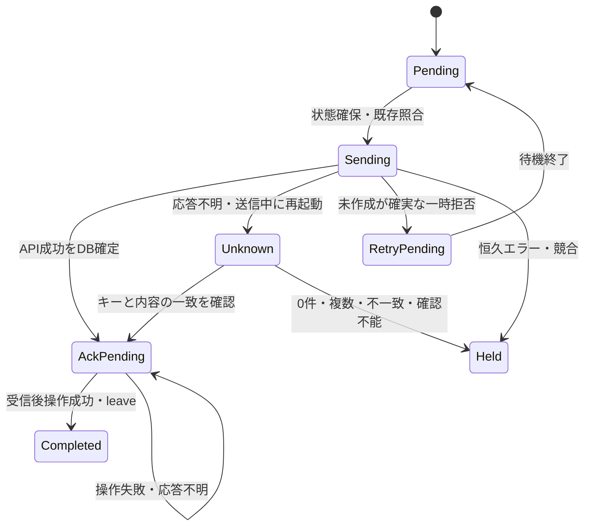

# 取り込み状態と API（設計案）

<!-- markdownlint-configure-file {"MD013": {"line_length": 120}} -->

## 1. 状態の置き場の比較

| 案 | 利点 | 欠点 |
| --- | --- | --- |
| Pleasanter の専用列だけ | 自前 DB 不要。利用者も外部キーを照合できる | 検索→作成は非原子的。応答不明・受信後処理・隔離履歴を管理しにくい |
| 専用 DB だけ | 一意制約・排他・受信位置と試行状態を管理できる | API 成功後 DB 確定前のクラッシュを照合できない |
| 専用 DB + Pleasanter の予約列 | 再起動復旧と外部照合を両立 | DB 運用・列の予約・ライセンス確認が必要 |

**第 2 段階は専用 DB + 予約列を条件付き推奨**。
Core.Data の `AppDatabase("mailingest", ...)` を再利用し、アプリ固有の表を作る。
初期は 1 台・SQLite の単発 CLI を推奨し、RDBMS / 複数ホストは次段階へ分ける。
Core のデュアル許諾と非寛容な SNI 推移依存の扱いが未解決のため、採用確定ではない。
ライセンス上の条件が満たせない場合は設計レビューへ戻し、無断で別 DB 実装を増やさない。

## 2. 外部キーとハッシュ

Message-ID が妥当なら、`sourceId` + 接続先識別子 + `siteId` + Message-ID から外部キーを作る。
可変なパスワードや URL の表記揺れをキーに含めず、接続先識別子は設定時に固定する。
符号化は UTF-8 の長さ付き各フィールドとキー方式版を連結し、SHA-256 の小文字 64 桁へする案。
曖昧な文字列連結はしない。Message-ID は外側の括弧と構文上の空白だけを正規化し、
ローカル部の小文字化・Unicode 正規化等の過剰な同一視はしない。
複数 Message-ID・制御文字・不正形式は隔離する。

Message-ID は送信者が偽装でき、全世界での一意性も保証できない。
別ソース間の同じ Message-ID は別レコードとする。
同じメールを POP3 と IMAP の両方へ定義すると別ソースとして二重になるため、
同じメールボックスを二重登録しない。ソース横断の重複排除は後続の明示機能とする。

| 識別値 | 用途 |
| --- | --- |
| 外部キー | Pleasanter の専用 `ClassZ` 等へ保存。作成と同じ API リクエストに含める |
| 内容ハッシュ | 正規化した Message-ID・件名・差出人・宛先・本文・送信日・添付情報の変化を検出 |
| 投射ハッシュ | 実際に管理する列の型付き正規値 + mappingRevision。`ClassY` 等へ併記 |
| 受信位置 | POP3 UIDL、IMAP folder + UIDVALIDITY + UID。メールサーバ上の操作用 |

ハッシュの正規化方式にも版を持たせる。オブジェクトのキー順と配列順序を規定する。
`fetchedAt` / 状態 / 試行時刻 / IMAP 既読フラグ等を内容ハッシュへ含めない。
投射ハッシュ自身の保存列と外部キー列は投射ハッシュの入力から除外する。
添付バイナリを保持しない案でも、同一 Message-ID の異なる添付を見逃さないよう、
受信上限内のストリームから添付パートの内容ダイジェストを取り、内容ハッシュへ含める。
デコード後サイズの検査はこの段階でも必要。ハッシュ値は匿名化済み情報とはみなさない。

Message-ID 欠落は **RAW SHA-256 の別名前空間**を代替キーとする案を推奨する。
UIDL / IMAP UID はサーバ・フォルダの識別であり、恒久の業務キーにはしない。
RAW が変わった再配送は同じメールと判断できない。隔離のみとする代替案も残す。
ヘッダを書き換えたメールや同一本文の別メールを完全に識別する保証はしない。

同一キー・同一内容は skip。同一キー・別内容は自動更新せず `Conflict`。
先着メールの内容を後着で上書きするルールは危険なため採らない。
内容衝突のメールは削除・既読化しない。

## 3. 専用 DB の最小モデル（案）

| 表 | 主な項目・制約 |
| --- | --- |
| IngestItems | Id、SourceId、DestinationId、SiteId、ExternalKey、キー版、内容・投射ハッシュ |
| IngestItems 続き | RecordId、MappingRevision、State、AttemptCount、NextAttemptAt、LastErrorCode、更新時刻 |
| MailLocations | IngestItemId、プロトコル、フォルダ識別、UIDL または UIDVALIDITY + UID、AckState |
| SourceRuns | ソース単位の実行所有者・運用排他情報、検査点、終了状態 |

`IngestItems` は `(DestinationId, SiteId, SourceId, ExternalKey)` を UNIQUE。
同じメールが複数の UID に現れても、レコードと受信後操作を別に追えるよう位置を分離する。
最終成功の管理対象列のハッシュ集合を保存し、手動編集との比較に使う。
本文・RAW・パスワード・ApiKey・添付バイナリを DB に保存しない。
原本はメールサーバに残す。原本が先に失われたら再変換できないことをエラーにする。
削除成功後の設定再投射はできないため、再処理は原本が存在する場合に限る。

日時は Core.Data の `DbTime` とネイティブ日時型を使う。アプリ固有のマイグレーションは 4 桁。
Core の共有ストアを取り込み台帳に流用しない。
履歴を削除すると重複判定が弱くなるため、既定では成功キーを消さない。
状態 DB のバックアップ・ディスク制限・保持期間の運用値は未決。
DB 消失を「初回」と黙って扱わず、回復モードで Pleasanter を照合する。
外部キーが削除・改変されていたら安全に再作成できないので手動確認とする。

**AppDatabase の起動マイグレーション排他は取り込みの実行排他ではない。**
初期は単一ホストの OS 排他と DB 一意制約を併用する。
同一状態 DB を使う CLI の同時実行を拒否し、ネットワーク共有上の SQLite と複数ホストは禁止する。
ロック喪失・期限切れで進行中 Create を自動的に引き継いで再送しない。
多重ワーカー対応はフェンシングと結果不明の回復を追加設計する。

## 4. 状態遷移と回復



作成と DB への確定を分散トランザクションにはできない。
`Sending` を送信前に永続化し、再起動で残っていたら結果不明扱いにする。
API 成功後 DB の確定に失敗した場合、受信後操作へ進まず失敗終了する。

| 境界で停止した場合 | 次回の挙動 |
| --- | --- |
| 取得だけ成功 | 再取得。サーバ上の原本はまだ変えない |
| API 作成済み・応答なし | 同じ予約キーで検索し、1 件かつ内容一致を確認して RecordId を回復 |
| 検索が 0 件 | **即 Create しない**。索引・レプリカ遅延・権限不足の可能性がある |
| 検索が複数 / 内容不一致 | 競合として保留。最初の 1 件で成功にしない |
| API 成功を DB 記録後・Ack 前 | API を再送せず、残った受信後処理だけ再開 |
| Ack 成功・DB 更新前 | UIDL / UID / 移動先の照合。レコードの再作成で解消しない |

結果不明の 0 件は時間を空けて検索のみ最大 3 回を初期案とし、解消しなければ保留する。
再 Create は運用者がサーバ側履歴等で未作成を確認した明示再開だけ。
可用性より重複防止を優先するため、初回送信前に停止した場合も手動確認が必要になり得る。
外部システムが同じ予約キーで並行作成できるなら完全な exactly-once は保証できない。
ツール所有列・予約列への編集と、別 DB の別インスタンスの書込みは禁止する運用を前提とする。

更新案は [対応づけ設定](メール対応づけ設定.md) を参照。
最終投射ハッシュと現在の管理対象値を比較し、人手の編集があれば保留する。
予約列のハッシュが同じでも本文を手動編集している可能性があるため、予約列だけを信用しない。
読取り→更新も原子的ではない。版条件による楽観排他の仕様が未確認の間は、
「管理対象列はツールだけが編集する」前提を要求する。競合検出の完全性を謳わない。

## 5. Pleasanter 標準 API

HTTPS の JSON POST。API キーはヘッダや URL でなくリクエストボディの `ApiKey`。
`ApiVersion` は **数値 1.1** を初期候補とする。
確認した本体の `App_Data/Parameters/Api.json` の値は 1.1。
製品の 1.5.x と API の 1.1 は別の版。対象版での往復確認は未実施。

| 操作 | パス | 主な要求・応答 |
| --- | --- | --- |
| サイト検査 | `api/items/{siteId}/GetSite` | 列定義・サイト種別・権限を確認 |
| 検索 | `api/items/{siteId}/Get` | View とトップレベルの Offset / PageSize |
| 1 件取得 | `api/items/{recordId}/Get` | 管理対象値と ID を照合 |
| 作成 | `api/items/{siteId}/Create` | 型付きマップと予約列。成功応答の Id を検証 |
| 更新 | `api/items/{recordId}/Update` | 管理対象列の差分。siteId で更新しない |

Upsert は初期の前提にしない。外部キー列の DB 一意制約や原子的 Upsert を確認したわけではない。
検索→Create の競合は、専用状態 DB と単一実行の制約で抑える。
API 層は通信と応答分類だけを受け持ち、再試行判断はユースケースに置く。
HttpClient のリダイレクトは無効とし、秘密を含む POST を別ホストへ転送しない。
Pleasanter に必要最小の閲覧・作成・更新権限を持つ専用ユーザーのキーを使う。
サイト書換え・削除・メール由来の権限変更は行わない。

予約キー照合の要求断片（ApiKey / ApiVersion は実送信時に追加）:

```json
{
  "View": {
    "ColumnFilterHash": { "ClassZ": "[\"<64文字の外部キー>\"]" },
    "ColumnFilterSearchTypes": { "ClassZ": "ExactMatch" }
  },
  "Offset": 0,
  "PageSize": 100
}
```

`ExactMatch` の列挙名とフィルター用プロパティは参照ソースで確認した。
配列を JSON 文字列にするフィルター形式と列ごとの動作は実機未確認。
この例を動作確認済み API 要求とは扱わない。
大文字小文字・権限による見え方・Class の選択肢設定をフェイクの契約試験と別途実機で確認する。
返ったレコードの外部キーも完全一致で検査する。

一覧の `Response.Offset` / `PageSize` / `TotalCount` / `Data` を検証してページ送りする。
1 ページ目の 0 件だけで未存在とせず、エラー・権限不足と区別する。
件数・応答上限・進まない offset を検出する。
サーバ側の PageSize 上限に従い、複数一致の可能性を最後まで調べる。
現在のテンプレート GetAsync は View しか受けないため、トップレベルの Offset / PageSize の口が必要。
JSON の大小文字は API の指定名を保つ。Web 既定の camelCase 化を無条件に当てない。

## 6. 応答検証・再試行・API 回数制限

HTTP 200 だけでは成功にしない。JSON と `StatusCode`、作成時の有効な Id、
一覧時の構造を検査する。HTML 応答・空 JSON・型不一致は異常として分類する。
API 応答の Message / Body はログしない。呼出し元が保存したキー・ID で照合する。

| 結果 | 初期案 |
| --- | --- |
| 401 / メール認証失敗 | 対象ソースを止める。毎通の自動再認証ループはしない |
| 400 / 403 / 404 | 内容・権限・設定の恒久エラー。メールを保留し、破壊操作しない |
| 429 | Retry-After を秒 / HTTP-date として解釈し、同じ接続先全体の送信を抑止 |
| GET 相当検索の 408 / 5xx / 通信失敗 | 上限付き再試行。検索自体は POST でも非更新操作 |
| Create / Update の 408 / 5xx / 通信失敗 | 反映済みの可能性があるため照合優先。単純再 POST しない |
| 429 の更新操作 | 未実行を保証できるゲートウェイ / 本体の拒否だけ再送候補。不明なら照合 |

429 に Retry-After が無ければ、1 秒開始・2 倍・ジッター付き・上限 60 秒・合計最大 3 試行を初期候補。
Retry-After が実行待機予算を超えたら値を短縮して早く送らず、NextAttemptAt を記録して非成功終了する。
同じ接続先へのリクエストは全ソース合計で同時 1、毎秒 1 回を初期候補とする。
API の日次枠もあるため、検索・照合・再試行を含む回数をサマリーに記録する。
`LimitPerDate` / `LimitRemaining` が返る場合は検査し、残量 0 なら新規送信を停止する。
未提供の残量を「無制限」と解釈しない。
設定値とテナント固有の上限は実機未確認。推奨値が本体の保証値という意味ではない。

キャンセルを再試行しない。中断後は Sending を Unknown として回復し、成功したと表示しない。
Q の「分類は API 層、再試行は呼出し側」を踏襲する一方、
Q の分類表だけで更新 POST を無条件再送しない。

## 7. 版差と未確認

2026-10-22 の事実確認は `626a173ec82e32f7055f3e76970a145b79c2296f`
（`Pleasanter_1.5.8.1`）のみ。本体は参照専用で、コードをコピーしていない。
[当時のソース][pleasanter-source] を根拠とし、必要時に取得した最新の版での再検証とは区別する。
参照時の版と、運用者が指定する本番版を分けて記録する。

1.5 系初期版・以降版のすべてで互換を実証していない。
GetSite・必要列・日時書式・検索・権限・ページ上限・レート制限は版別の契約試験を作る。
未確認機能は明示的な接続プロファイルで禁止し、失敗を別の列や部分一致検索へ黙って置き換えない。
最初の実装対象版・記録テーブル以外への対応・楽観排他は設計レビューの未決事項。

[pleasanter-source]: https://github.com/Implem/Implem.Pleasanter/tree/626a173ec82e32f7055f3e76970a145b79c2296f/Implem.Pleasanter
